<p align="center">
  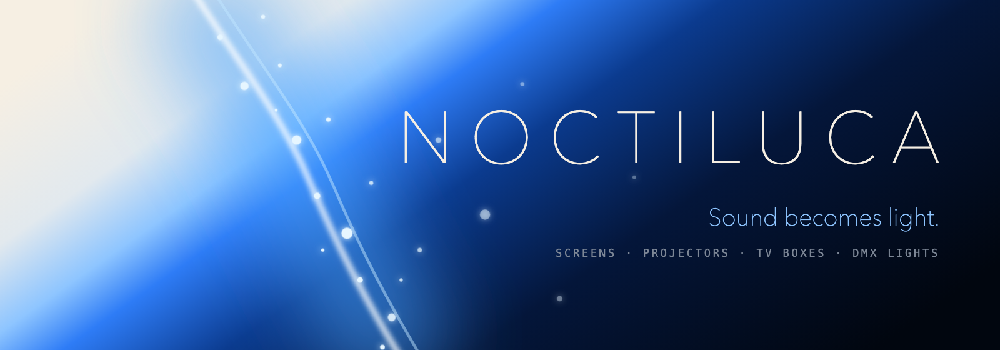
</p>

<p align="center">
  <a href="https://sagistiki.github.io/noctiluca/"><b>sagistiki.github.io/noctiluca</b></a><br><br>
  <b>A live club visualizer for macOS.</b><br>
  It listens to the room, finds the kick, reads the vibe, and plays the night<br>
  on screens, projectors, TV boxes and DMX lights, in sync.<br>
  Techno, house, trance: anything built on a kick.
</p>

<p align="center">
  
  
  
  
</p>

<p align="center">
  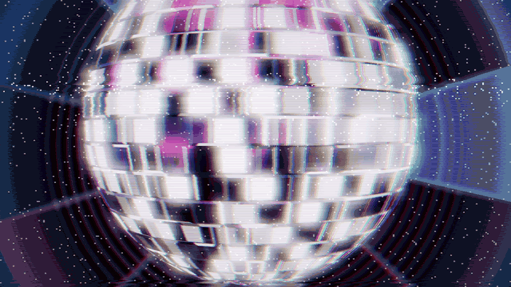
</p>

> *Noctiluca* is a sea plankton that glows when the water moves. This one glows when the music does.

---

## `01` · What it does

- **Listens.** A microphone (or any input) is enough. It tracks the tempo and the beat grid, hears every kick, and knows the section: groove, build, drop, breakdown.
- **Reads the vibe.** Dark or bright, calm or intense, smooth or raw, measured over the last seconds, and the looks follow it.
- **Directs itself.** A director picks themes, backgrounds, patterns, 3D objects, atmospheres and effects, changing on phrase boundaries, cross-fading on the beat. Or take it over by hand.
- **Plays anywhere.** The Mac's screen, up to four outputs (projectors, displays), Android TV boxes over Wi-Fi, and DMX lights over USB.
- **Maps the room.** Up to eight surfaces, each warped onto a wall, a pillar or a ceiling, with a calibration grid that is projected right onto them.
- **Keeps people safe.** Never more than three flashes a second, whatever the music does.

## `02` · Looks

<table>
  <tr>
    <td>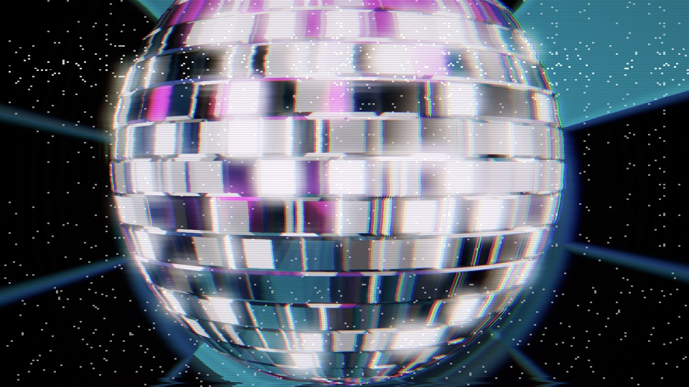</td>
    <td>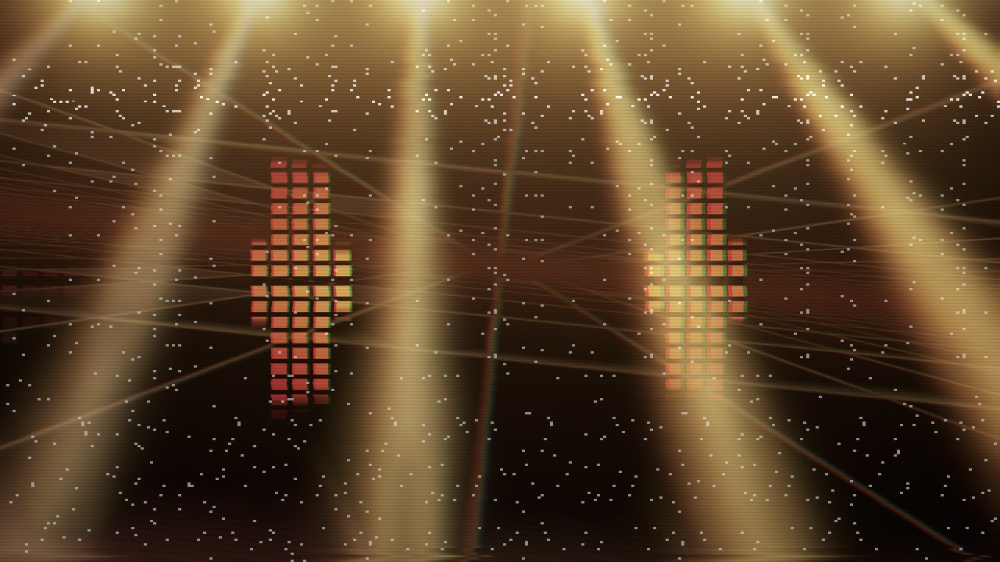</td>
    <td>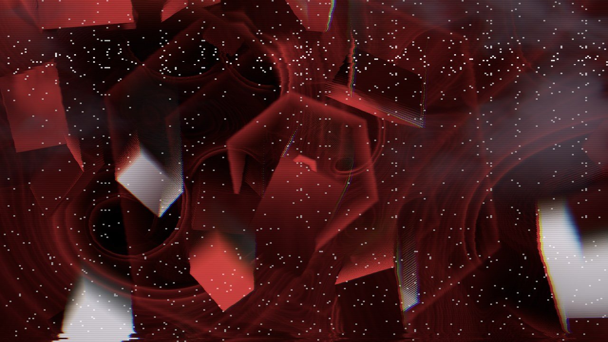</td>
  </tr>
  <tr>
    <td>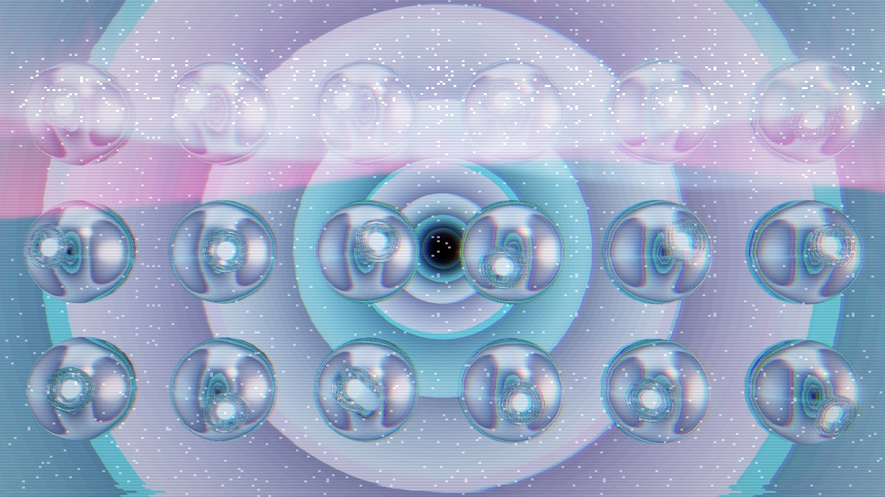</td>
    <td>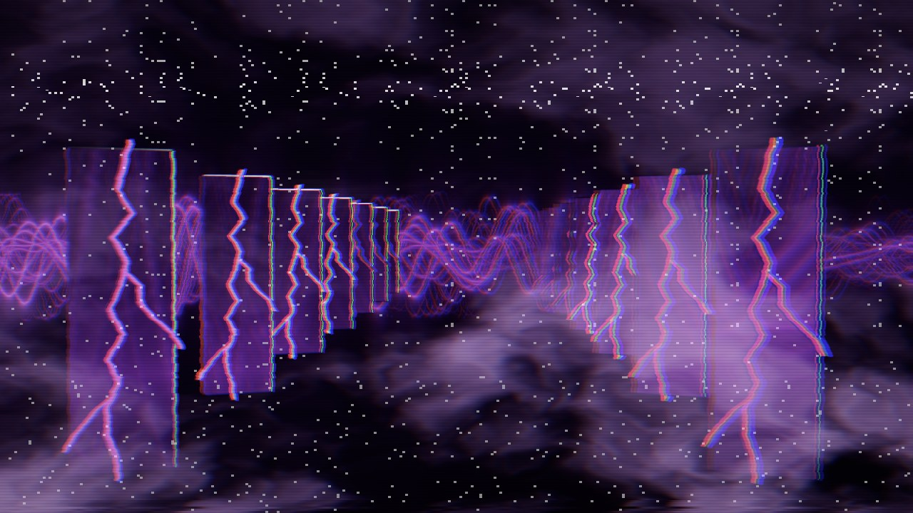</td>
    <td>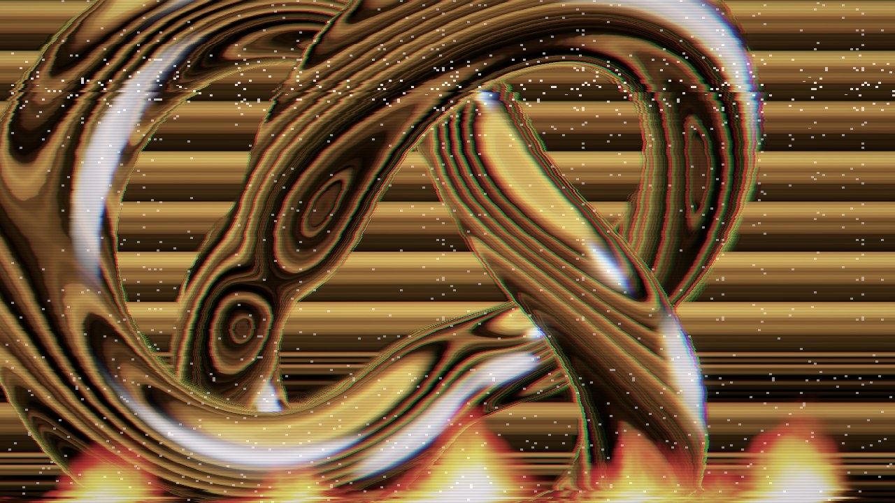</td>
  </tr>
</table>

Nineteen themes, from clean to luxurious to heavy, each a world the director builds looks from: Red room · White corridor · Terminal · Ultraviolet · Amber · Rainbow · Gold room · Marble hall · Noctiluca · Velvet · Liquid chrome · Bauhaus · Acid warehouse · Infrared · Deep space · Arctic · Jungle night · Holographic · Cathedral.

| | |
|---|---|
| **Backgrounds** (20) | tunnel · laser grid · liquid · 3D lattice · void · marble · night sea · nebula · mirror room · LED tunnel · concrete · mercury · contours · plasma · glass cells · fractal dive · ink · lasers through haze · dusk sky · silk |
| **Patterns** (22) | rings · scope · kaleidoscope · spectrum bars · stripes · frames · radar · square spiral · halftone · Lissajous · moiré · ribbon · Truchet · barcode · flower of life · checker warp · strings · mandala · ASCII · string art · pixel sort · orbits |
| **3D objects** (24) | mirror ball · skull · prism · gem · knot · eye · monolith · chain · speakers · crystal · planet · corridor · classical bust · diamonds · vinyl · jellyfish · rose · liquid metal · pyramid · moon · DNA · butterflies · cube swarm · astronaut, in chrome or glass (the moon in stone), each in its own composition |
| **Atmospheres** (13) | storm with lightning · smoke · fire · moving-head beams · aurora · snow · rain · bubbles · fireflies · god rays · caustics · lens flares · shooting stars |
| **Effects** (19) | trails · zoom · kaleido · drift · CRT · prism · floor · VHS · thermal camera · film · chroma · glow · datamosh · feedback · riso · slit scan · heat haze · iridescent · long exposure |
| **Palettes** (22) | neon · acid · fire · ice · ultraviolet · gold · rose gold · noctiluca · vaporwave · sunset · forest · blood orange · pastel · cyber · bauhaus · infrared · aurora, and five of one colour on black |

One look gives way to the next with a fade, an ink blot spreading, or a flight through the old look on the drop. On a build the camera pushes in, on the drop everything hits at once, and through a breakdown everything slows down.

## `03` · The app

<p align="center">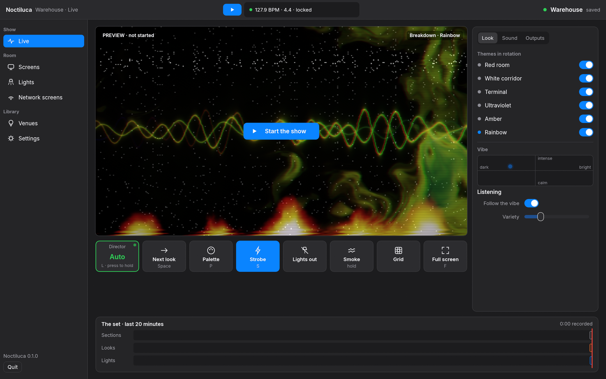</p>

A control window in the spirit of pro audio and video apps: a toolbar with the transport and the beat, a sidebar of sections, an inspector.

- **Live** · the program, pads (Director: Auto or Held, Next look, Palette, Strobe, Lights out, Smoke, Grid, Full screen), an inspector for the look, the sound and the outputs, and a timeline of the last twenty minutes: sections, looks, light effects.
- **Screens** · projection mapping.
- **Lights** · DMX.
- **Network screens** · TV boxes on the Wi-Fi.
- **Venues** · whole set-ups saved per place.
- **Settings** · flash safety, sync, quality.

## `04` · Projection mapping

<table>
  <tr>
    <td width="50%">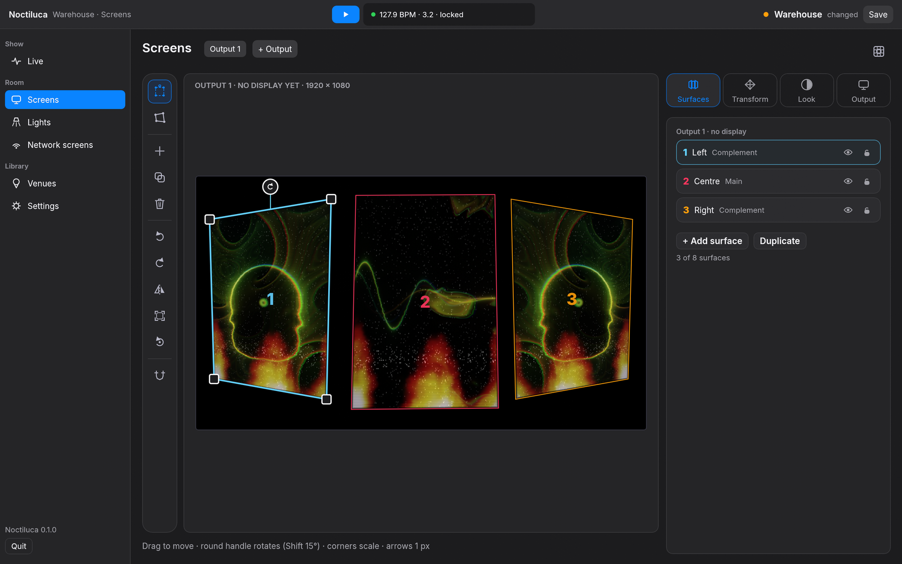</td>
    <td width="50%">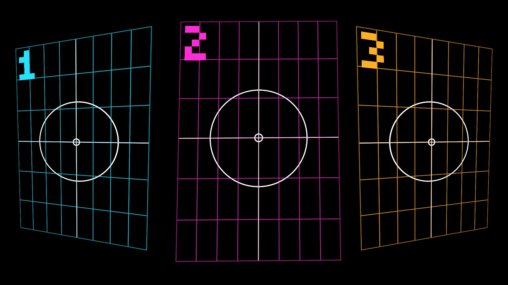</td>
  </tr>
</table>

- Up to **8 surfaces** on up to **4 outputs**; split them across projectors or keep several on one.
- **Transform** (move, rotate with 15° snaps, scale about the middle) and **Corner pin** (corners and edges) tools; arrows move one pixel; true perspective (homography), never a stretch.
- One or two **Main** surfaces; the others **Same** (a copy) or **Complement**: same colours and beat, a different picture: **Mirror** (the stage symmetric), **Chase** (a soft light running across the surfaces in the last bar of each phrase) or **Echo** (Main, one beat later).
- For **walls seen from the side and ceilings**: turn the picture inside its corners, and give a surface its real shape so circles stay round and 3D keeps its proportions.
- While mapping, the projector shows the show with the selected surface outlined on the wall itself.

## `05` · Network screens

Any **Android TV box** on the Wi-Fi becomes an output, mapped like a projector. Noctiluca finds the boxes, installs its small receiver app on them (over network debugging, from the Network screens page), and streams H.264 from the Mac's hardware encoder. The two clocks are kept in step and every frame is drawn ahead by the measured delay, so a TV across the room lands on the same beat as the projector.

The receiver lives in [`android/`](android/): plain Android, no libraries, hardware decoding, frames shown at the exact moment asked for, HDMI game mode on request.

## `06` · DMX lights

<p align="center">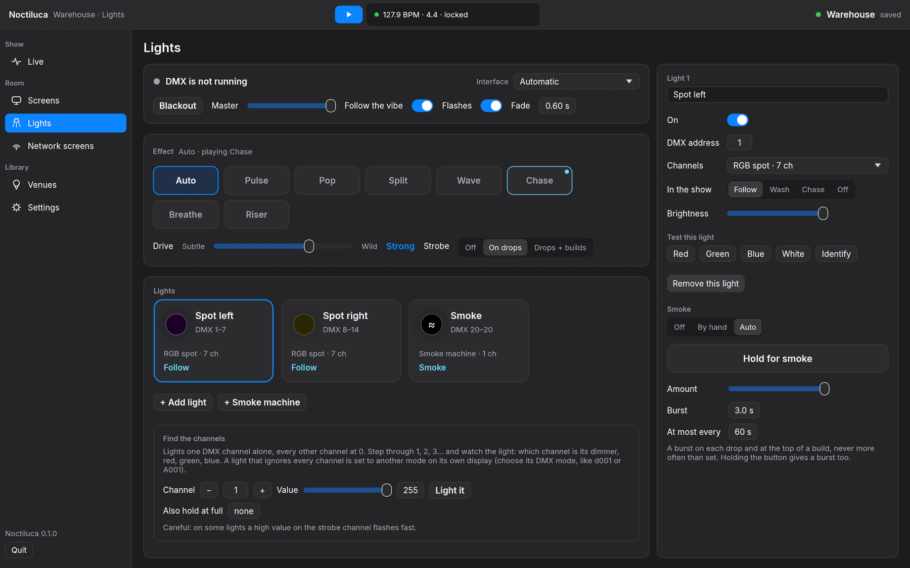</p>

- **USB-DMX**: Open DMX (FTDI) and Enttec DMX USB Pro style interfaces, told apart automatically.
- **Lights** as cards with their live colour: RGB, dimmer + RGB, the common 7-channel RGB spot, RGBW, a smoke machine, or any custom channel list. A **channel finder** for lights whose manual is lost.
- **Effects**: Pulse · Pop · Split · Wave · Chase · Breathe · Riser. **Auto** follows the section and the vibe and changes on phrases; or lock one.
- **Drive**: one slider from *subtle* to *wild*: how bright, how deep the dips between hits, how fast things move, how snappy the fades, how vivid the colours.
- **Strobe** hits on drops (and at the top of builds), through the same three-a-second limit. The lights' own strobe channels are never used.
- **Smoke**: by hand, or a burst on the drop, never more often than you set.

## `07` · Venues

<p align="center">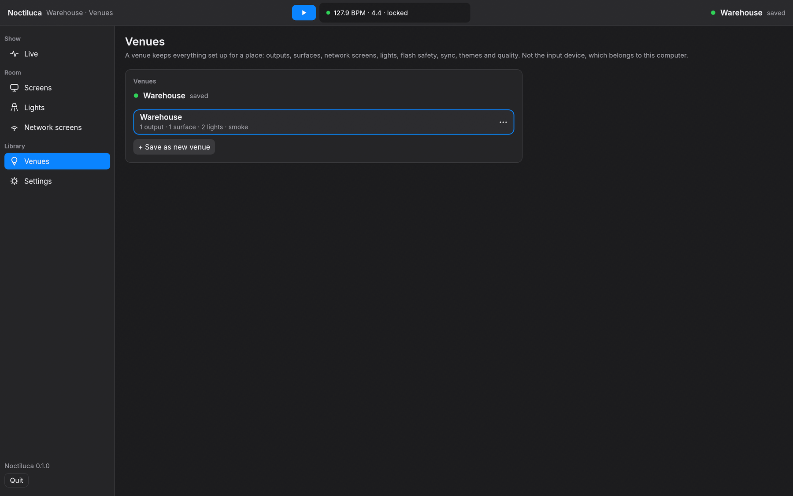</p>

A venue is a project file: one readable JSON file, `name_nocvenue.json`, with everything set up for a place (outputs, surfaces, network screens, lights, safety, sync, themes, quality). They live in `~/Documents/Noctiluca Venues` or anywhere you save them. **Open…**, **Save** and **Save As…** work as in any Mac app (⌘O, ⌘S, ⇧⌘S), and a venue file dropped on the window opens. The input device stays with the computer. Opening over unsaved changes asks first.

## `08` · Run it

### Download

Get `Noctiluca-…-macos-arm64.zip` from [Releases](https://github.com/sagistiki/noctiluca/releases) (Apple silicon, macOS 13 or later), unzip it and move **Noctiluca.app** to Applications.

The app is not notarized by Apple, so the first time macOS refuses to open it. Open it once, then go to **System Settings → Privacy & Security** and press **Open Anyway** (or run `xattr -dr com.apple.quarantine /Applications/Noctiluca.app`). It asks for the microphone, and for the local network when you use TV boxes.

To install the receiver on TV boxes it needs `adb`: `brew install android-platform-tools`.

### Build from source

Requirements: macOS 13 or later, [Rust](https://rustup.rs) 1.95 or later.

```bash
git clone https://github.com/sagistiki/noctiluca
cd noctiluca
cargo run --release
```

It opens on **Live** and listens to the microphone. Press **Start the show**, or Space.

Build the Mac app (with the TV receiver inside, if Java and the Android SDK are around):

```bash
./package_app.sh            # → ~/Documents/Noctiluca.app
```

| Want to | Run |
|---|---|
| Play a WAV file instead of listening | `cargo run --release -- --file track.wav` |
| Choose the input | `cargo run --release -- --device "BlackHole"` |
| Use a network screen and start at once | `cargo run --release -- --screen "Living room" --play` |
| No flashes at all | `cargo run --release -- --no-strobe` |
| The same show every time | `cargo run --release -- --seed 7` |
| Make the synthesized test track | `cargo run --example gen_track` |
| All the options | `cargo run --release -- --help` |

### Keys (while the show is full screen)

| Key | |
|---|---|
| `Space` | a new look now |
| `L` | hold the look (the Director to *Held*), again to let go |
| `1`–`5` · `Q`–`Y` · `Z X C` | background · pattern |
| `P` · `O` · `G` · `B` · `A` | palette · effect · 3D object · chrome or glass · atmosphere |
| `S` | strobe on or off |
| `[` `]` | visuals 10 ms later or earlier, for this room |
| `I` · `H` · `F` | next input · overlay always on · full screen |
| `Esc` · `Cmd+Q` | back to Live (the show goes on) · quit |

## `09` · Flash safety

Fast flashing can trigger seizures in people with photosensitive epilepsy. Every flash, on screen and in the lights, goes through one limiter: **at most three a second** (WCAG 2.3.1), each one only fading once it starts. Anything faster becomes a shallow shimmer. `S` turns flashes off, and so does `--no-strobe`.

## `10` · How it is built

```
src/
  analysis/      FFT, kick and beat tracking, sections, the vibe
  director.rs    the looks, and when they change
  sync.rs        the beat clock, running ahead of the program's own delay
  render/        wgpu: views, compositor (mapping), projector, readback
  stage.rs       surfaces → what each output draws
  mapping.rs     homography, corner pin, rotation
  net/           network screens: discovery, protocol, clock sync, VideoToolbox H.264
  lights.rs      the DMX light engine, effects, Drive, smoke
  dmx.rs         Open DMX / Enttec Pro over USB serial
  ui/            the control window (egui)
shaders/         WGSL, reloaded live while you edit them
site/            the website (GitHub Pages, published by .github/workflows/pages.yml)
assets/models/   the 3D objects (glTF), made in Blender (blender/build_models.py)
android/         the TV box receiver
docs/brand/      the icon and banners as SVG/HTML, rendered by render.sh
```

Rust 2024 · [wgpu](https://wgpu.rs) on Metal · [egui](https://github.com/emilk/egui) · cpal · rustfft · VideoToolbox. About 290 tests: `cargo test --release`.

## `11` · Roadmap

- [ ] **Look editor**: build your own looks inside the app. Make new themes from the backgrounds, patterns, objects, atmospheres, effects and palettes; bring in your own images, 3D models (glTF) and templates; tune how each one reacts to the kick, the build and the drop; save them and hand them to the director.
- [x] **A much bigger library**: new themes, backgrounds, patterns, 3D objects, atmospheres, effects and palettes, from clean and minimal to luxurious to heavy FX.
- [ ] **MIDI controllers** with Learn: any pad, knob or fader to any action.
- [ ] **3D stage**: plan the room (walls, screens, projectors, lights) in 3D before the gig.
- [ ] **Clips and logos**: your own videos, logos and text over the show.
- [ ] **Bigger rigs**: more projectors and network screens, ready in a few clicks.
- [ ] **Show safety**: autosave, a panic button, and a health view of every output.
- [ ] **Gig setup wizard**: from a new room to a running show, step by step.

## License

[MIT](LICENSE). The Inter font is under the SIL Open Font License ([assets/fonts/Inter-LICENSE.txt](assets/fonts/Inter-LICENSE.txt)).

Three 3D models come from free collections; the rest are built in [blender/build_models.py](blender/build_models.py):
- Skull: *Scattering Skull* by Vladimir Petkovic, [Khronos glTF Sample Assets](https://github.com/KhronosGroup/glTF-Sample-Assets/tree/main/Models/ScatteringSkull), CC0.
- Bust: *Marble Bust 01* by Rico Cilliers, [Poly Haven](https://polyhaven.com/a/marble_bust_01), CC0.
- Astronaut: [NASA 3D Resources](https://github.com/nasa/NASA-3D-Resources/tree/master/3D%20Models/Astronaut) (model by DigitalSpace), courtesy of NASA.

<p align="center"><sub>Made for the dance floor.</sub></p>
